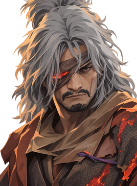
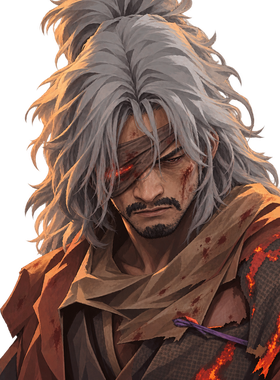
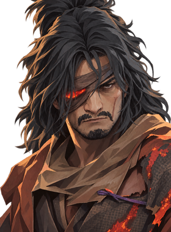
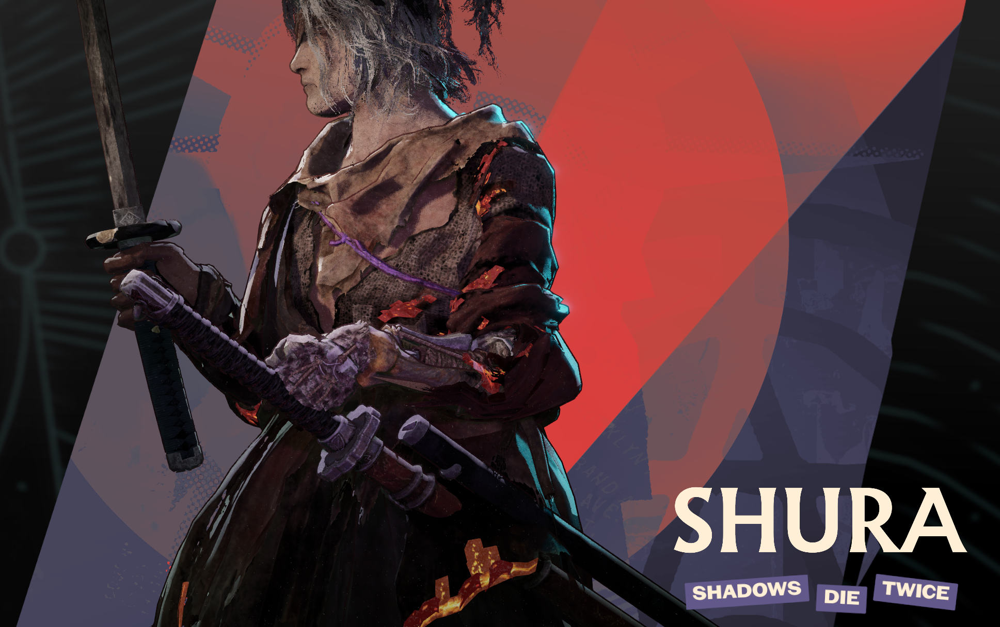
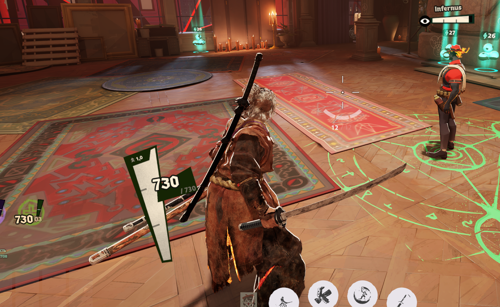

[Русский](README.ru.md)

# Sekiro: Shura / Wolf for Yamato — v1.0

Wolf in the Shura outfit replaces Yamato. Includes Kusabimaru, the red Mortal Blade, a black back-mounted sword, custom attack and ability effects, and a Sekiro-inspired deflect. Shadow Transformation uses black hair and a glowing red eye. The selection name is Shura, with Shadows · Die · Twice tags.

[Download v1.0](https://github.com/hqvdvn-cmd/sekiro-shura-deadlock/releases/tag/v1.0)

[GameBanana: downloads and one-click install](https://gamebanana.com/mods/730456)

This release keeps reload A, selected after in-game comparison. The normal, low-health and killstreak portraits now share a painted style. **The Japanese voice pack still needs work:** some synthetic lines sound choppy. A voice update is planned.

## Install with a mod manager

Close Deadlock and your manager. Disable earlier Yamato replacements. Import `sekiro-shura-v1.0-standalone-r2.zip` and enable all three components: model/UI/voices, Yamato effects and ultimate binding.

With **Dota 2 → Deadlock**, keep Shura's model and effects enabled, disable its standalone ultimate-binding component, then import and enable `sekiro-shura-v1.0-dota-patch-r2.zip`. Keep all five D2D components enabled. Use one Shura binding variant at a time.

## Manual installation

1. Close the game and manager. Back up `game/citadel/gameinfo.gi`.
2. In Steam, open Deadlock → Properties → Installed Files → Browse, then `game/citadel`.
3. Remove only the previous Shura files, checking their old manifest. Copy the three VPK files from the standalone ZIP into `addons`. Do not overwrite unrelated mods with the same filenames.
4. In `gameinfo.gi` → `FileSystem` → `SearchPaths`, place `Game citadel/addons` above `Game citadel`. Keep the other game/language paths and explicit `Mod`/`Write` entries for both `citadel` and `core`.

With D2D, replace only Shura's `pak16_dir.vpk` and manifest with the compatibility ZIP versions. To uninstall, remove only files matching your downloaded manifest. Managers may renumber VPKs.

## Portraits

Normal · low health · killstreak:

  

## Known limits

- Some Japanese synthetic voice lines are rough or choppy. Voice replacement remains unfinished.
- A short blue flash may remain at parry startup. Shared movement and parry effects keep their native colors.
- English/Russian names and tags can conflict with other localization mods. Other Yamato replacements can conflict with the model or ability bindings.

The owner checked the model, reload and ultimate in a combined local setup and selected reload A. The latest low-health/killstreak portraits have packed-texture checks; separate in-game confirmation is pending. A clean standalone match has not been recorded.

## After a game update

Extract the main ZIP and run `python verify.py --game-dir "YOUR_STEAM_PATH/Deadlock/game/citadel"` with Python 3.10+. It checks package hashes and 16 native references without changing or launching the game. It covers selected resources; a pass does not prove every game change is compatible. Managers do not run this check automatically.

For bug reports, include a screenshot or clip, the action/pose, game build and other mods.

Original Sekiro assets: FromSoftware. Shura fixes: [sekijuan](https://www.nexusmods.com/sekiro/mods/1486). Deadlock: Valve. [Full credits](CREDITS.md).
